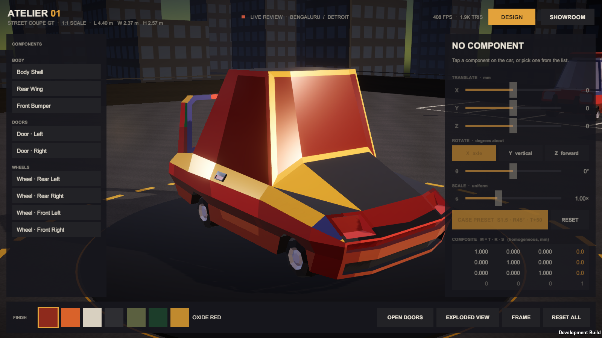
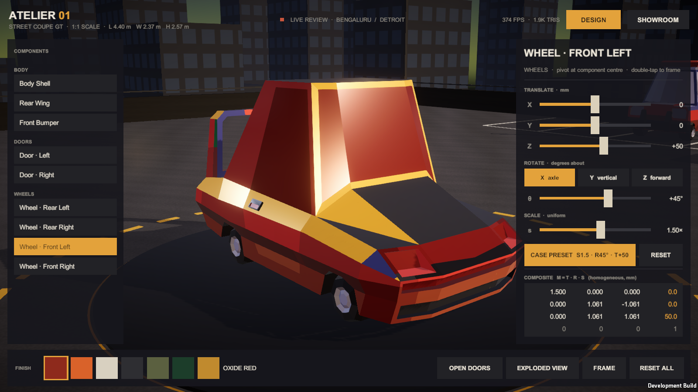
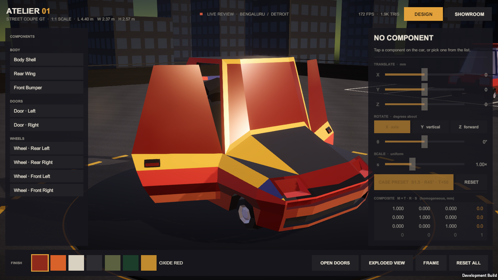
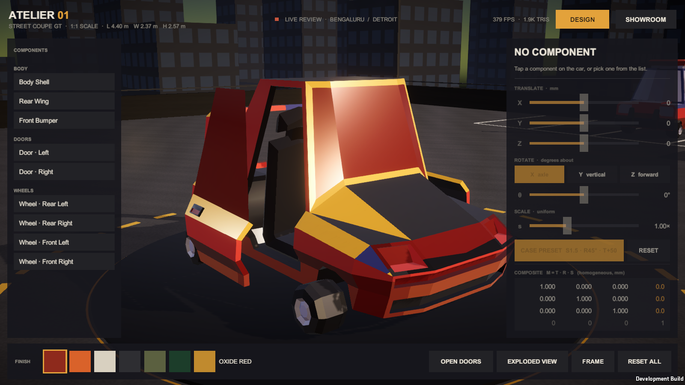
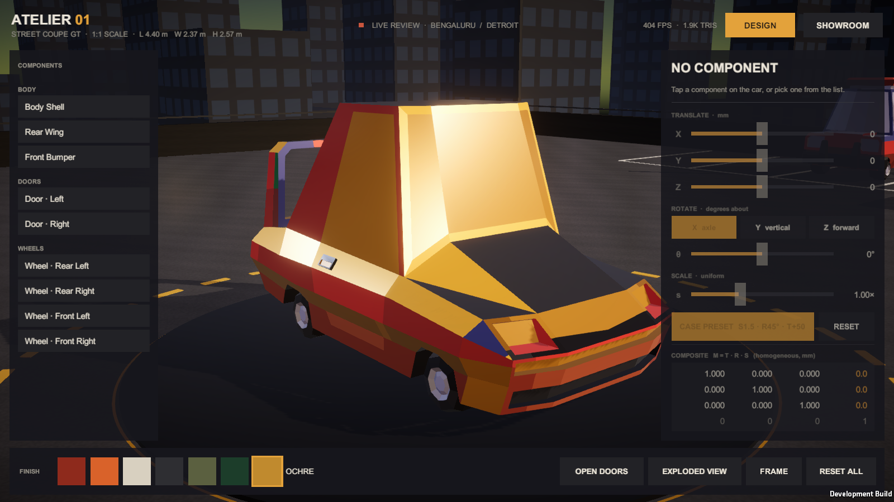
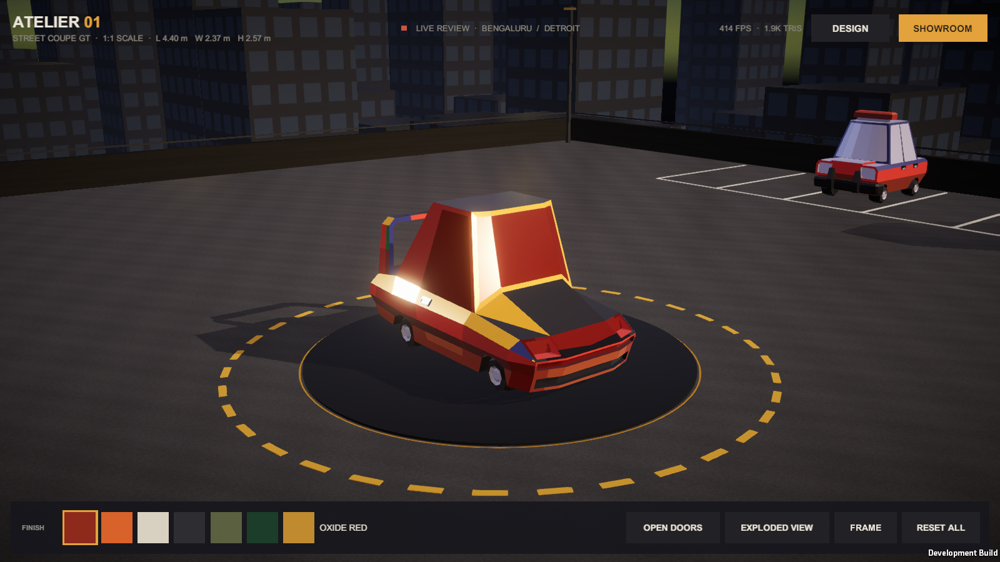

# Atelier Car Designer — CS4104 CG & VR Case Study

**Case Study 2 – Industrial Design and Architecture:** design teams in Bengaluru and Detroit review and edit a 1:1 car
prototype together in a virtual environment. This repository holds the working Unity prototype and the case-study report.

Pranav Nayak · USN 1RVU23CSE344 · Section C · RV University, School of Computer Science and Engineering ·
Guide: Prof. Shyam Mohan J S · 2026–27

📄 **Report:** [`docs/1RVU23CSE344_CGVR_CaseStudy_Report.pdf`](docs/1RVU23CSE344_CGVR_CaseStudy_Report.pdf)



## What the prototype does

- Loads the car as **9 separately selectable parts** (body shell, front bumper, rear wing, 2 doors, 4 wheels) at 1:1 scale.
- **Select** a part by clicking it (physics raycast) or from the list; the selected part gets an orange rim highlight.
- **Scale, rotate and translate** any part about its own centre and see the live **4 × 4 composite matrix
  M = T · R · S** (homogeneous coordinates).
- **Case Preset** applies the assignment task — scale the front-left wheel by 1.5, rotate it 45° about the axle and
  move it 50 mm forward — and the matrix panel shows 1.500, 1.061, −1.061 and 50.0, matching the hand calculation.
- **Open Doors** (hinged at the front edge), **Exploded View**, **Frame**, **Reset All**, seven **paint finishes**,
  and a **Showroom** mode that auto-rotates the camera.
- Background: a **rooftop parking deck in a city at dusk** — parking bays, parapet, lamp posts, stair tower, parked
  cars and a lit skyline under a procedural sunset sky — generated entirely from code.

| Case preset (S1.5 · R45° · T+50) | Doors open | Exploded view |
| --- | --- | --- |
|  |  |  |
| **Ochre finish** | **Showroom mode** | |
|  |  | |

Measured in a Windows development build at 1600 × 900 (vsync off): **412–461 FPS** (2.17–2.43 ms per frame);
the car is 1.9K triangles and the whole scene about 20K.

## Run it

1. Install **Unity Hub** and the Unity Editor **6000.0.85f1** (Unity 6).
2. Clone this repo, then in Unity Hub choose **Add → Add project from disk** and select the cloned folder.
   The first open takes a few minutes while Unity rebuilds its `Library` cache.
3. In the **Project** window open `Assets/CarDesigner/Scenes/CarStudio.unity`.
4. Set the **Game** view to a 16:9 size (for example *Full HD 1920×1080*) and press **Play**.

**Controls:** left-drag orbits, mouse wheel zooms, right/middle-drag pans, click selects a part, double-click frames it
(double-click empty space resets the view). Touch: one finger orbits, pinch zooms, two fingers pan.

If the scene ever looks empty or broken, use the menu **Car Designer → Rebuild Studio Scene** — the whole scene is
rebuilt from the scripts and the model file. **Car Designer → Build Windows Player** produces
`Builds/Windows/AtelierCarDesigner.exe`.

## Project layout

```
Assets/CarDesigner/
  Models/          LowPolyCarsPack.fbx (15 cars) + tx_Palette_Base.png
  Scenes/          CarStudio.unity (generated by StudioSceneBuilder)
  Scripts/Runtime/ CarRig, CarPart, DesignEdit (T·R·S about the part centre), PartSelector (raycast + highlight),
                   OrbitCamera, CarPaint (palette recolouring), CarSwitcher, UI/DesignerUI + UiKit
  Scripts/Editor/  StudioSceneBuilder (builds the scene, materials, lights, URP asset),
                   CityGarageEnvironment (rooftop deck + skyline), PlayerBuilds, StudioAutomation
  Shaders/         SelectionRim.shader (Fresnel rim glow on the selected part)
docs/              Case-study report (PDF)
output/            Screenshots from the build
```

To show a different car from the pack, change `HeroCar` (and `HeroDisplayName`) at the top of
`StudioSceneBuilder.cs` and run **Car Designer → Rebuild Studio Scene**. Available cars: Car01_1, Car01_2, Car02_1,
Car02_2, Car02_3, Car03_1, Car03_2, plus variants such as Car03_2_Racing and Car01_2_Taxi.

## Credits

Car models: **BTG Low Poly Car Pack** by BetelgeuseMan — <https://betelgeuseman.itch.io/lpc-pack> — licensed
[CC BY 4.0](https://creativecommons.org/licenses/by/4.0/). Everything else (code, generated environment and textures)
was written for this case study.
